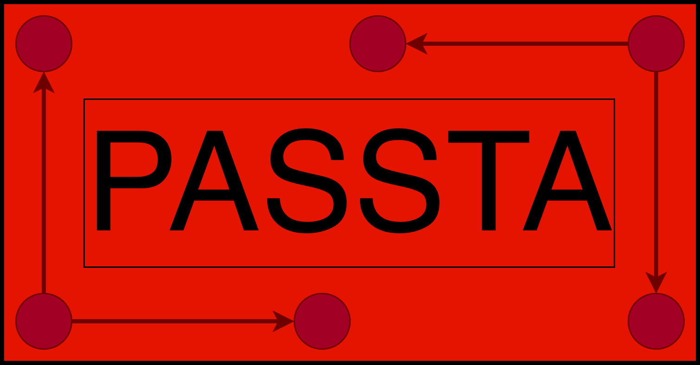

<p align="center">
  
</p>

<h1 align="center">PASSTA</h1>

<p align="center">
  Learning Stochastic Real-Time Automata from execution traces.
</p>

<p align="center">
  
  
  
  
  
  
  
  
</p>

<p align="center">
  🚧 In development 🚧
</p>

## Status

PASSTA is currently under active development. APIs, command-line options, parser configuration, visualization behavior, and internal packages may change between versions.

### Platform-specific builds

PASSTA source code is cross-platform. However, JavaFX uses native libraries
that depend on the operating system and processor architecture.

The automated build produces separate executable JARs for:

- Linux x64;
- Windows x64;
- macOS ARM64;
- macOS Intel.

Use the artifact corresponding to the target platform:

```text
passta-0.4.0-linux-x64.jar
passta-0.4.0-windows-x64.jar
passta-0.4.0-macos-arm64.jar
passta-0.4.0-macos-x64.jar
```

## Table of contents

- [Quick start](#quick-start)
- [Features](#features)
- [Description](#description)
  - [Learning workflow](#learning-workflow)
  - [Trace model](#trace-model)
  - [Learned automata](#learned-automata)
  - [Visualization and export](#visualization-and-export)
  - [Validation](#validation)
  - [Usage modes](#usage-modes)
  - [Scope and limitations](#scope-and-limitations)
- [Architecture overview](#architecture-overview)
- [Technologies](#technologies)
- [Installation](#installation)
- [Command-line usage](#command-line-usage)
  - [General syntax](#general-syntax)
  - [CLI examples](#cli-examples)
- [Java API usage](#java-api-usage)
- [Project structure](#project-structure)
- [Experimental data and reproducibility](#experimental-data-and-reproducibility)
- [Changelog](#changelog)
- [Citation](#citation)
- [License](#license)

## Quick start

Build PASSTA from the project root:

```bash
mvn clean package
```

The executable shaded JAR is generated in:

```text
dist/passta-0.4.0.jar
```

Show the available commands:

```bash
java -jar dist/passta-0.4.0.jar --help
```

Open a learned automaton in the JavaFX viewer:

```bash
java -jar dist/passta-0.4.0.jar \
    view data/traces.json 2
```

Export an automaton to SVG:

```bash
java -jar dist/passta-0.4.0.jar \
    export data/traces.json 2 out/automaton.svg
```

Export an automaton to PNG:

```bash
java -jar dist/passta-0.4.0.jar \
    export data/traces.json 2 out/automaton.png
```

Export an automaton to UPPAAL:

```bash
java -jar dist/passta-0.4.0.jar \
    export data/traces.json 2 out/model.xml
```

The value of `k` must be an integer greater than or equal to `1`.

## Features

- Learns **Stochastic Real-Time Automata (SRTA)** from JSON execution traces.
- Reads traces lazily through `Stream<Trace>`.
- Accepts a JSON file or a directory of JSON files as a trace source.
- Provides a command-line interface for learning, visualization, and export.
- Includes an interactive JavaFX automaton viewer.
- Supports movement of locations, edges, self-loops, and labels.
- Exports automata to PNG, SVG, and UPPAAL XML.
- Preserves manually adjusted layouts when exporting from the viewer.
- Validates additional traces against learned automata.
- Reports accepted and rejected traces through `ValidationResult`.
- Can save rejected traces together with diagnostic information.

## Description

PASSTA is a Java-based tool for learning **Stochastic Real-Time Automata (SRTA)** from execution traces collected from real or simulated systems.

PASSTA is intended for workflows involving:

- behavioral model inference;
- analysis of event-driven and time-sensitive systems;
- formal digital twins;
- protocol analysis;
- model-based validation;
- anomaly and rejection analysis;
- preparation of learned models for formal verification.

### Learning workflow

The standard PASSTA workflow consists of the following steps:

1. Collect execution traces from a real system, simulator, test environment, or monitoring infrastructure.
2. Represent the observations using PASSTA's JSON trace format.
3. Select the learning parameter `k`.
4. Run the PASSTA learning algorithm.
5. Obtain a learned `SRTA` model.
6. Inspect the automaton using the interactive JavaFX viewer.
7. Export the model to PNG, SVG, or UPPAAL XML.
8. Validate additional traces against the learned automaton.

The input source may be either a single JSON file or a directory containing multiple JSON files. Directory inputs are processed in filename order.

Trace reading is performed lazily through `Stream<Trace>`. This allows PASSTA to process traces incrementally instead of materializing the complete input in memory before learning or validation.

Streams returned by `TraceReader.readTraces(...)` retain I/O resources while they are consumed and must therefore be closed using try-with-resources.

### Trace model

PASSTA expects JSON files whose root element is an array of traces. Each trace contains a list of observations.

Each observation has:

- `time`: elapsed time from the beginning of the trace;
- `event`: event name, or an empty string when no event occurs;
- `variables`: list of observed system attributes.

Example:

```json
[
  {
    "obs": [
      {
        "time": 0.0,
        "event": "",
        "variables": ["Initializing"]
      },
      {
        "time": 13983775.0,
        "event": "Init_complete",
        "variables": ["Listening"]
      },
      {
        "time": 14311815.0,
        "event": "Rs_slave",
        "variables": ["Uncalibrated"]
      },
      {
        "time": 14881755.0,
        "event": "Master_clock_selected",
        "variables": ["Slave"]
      }
    ]
  }
]
```

PASSTA uses the ordering, timing, events, and observed variables to construct the automaton. Repeated behaviors across traces contribute to the learned structure and to the statistical information associated with transitions.

### Learned automata

The learned model is represented by the `SRTA` class. It contains locations and edges derived from the observations in the training traces.

A location may contain:

- a unique identifier;
- observed attributes;
- timing information or invariants;

An edge may contain:

- its source and target locations;
- the event that triggers it;
- a timing interval or guard;
- the samples from which it was inferred;
- an estimated probability when available.

The learning parameter `k` controls part of the model-generation and location-merging process. It must be an integer greater than or equal to `1`.

Different values of `k` can produce models with different levels of abstraction.

### Visualization and export

PASSTA includes an interactive JavaFX viewer for exploring learned automata.

The viewer supports:

- zooming and panning;
- fitting the complete graph to the window;
- resetting the initial layout;
- dragging locations;
- adjusting edges and self-loops;
- moving edge labels independently;
- selecting locations and edges;
- inspecting model details;
- exporting the current layout to PNG or SVG.

Moving graphical elements changes only the displayed layout. It does not modify the underlying `SRTA` model.

PASSTA supports the following output formats:

- **PNG**, for raster images suitable for reports and presentations;
- **SVG**, for scalable vector graphics and further editing;
- **UPPAAL XML**, for analysis with UPPAAL-compatible workflows.

PNG and SVG exports use the JavaFX renderer.

Exports initiated from the interactive viewer preserve the manually adjusted positions of locations, edges, self-loops, and labels.

Exports performed directly from an `SRTA` through `AutomatonExporter` use the automatically generated layout.

Command-line graphical exports create the visual representation in memory without opening the interactive viewer.

### Validation

A learned automaton can be used to validate additional execution traces.

Validation determines whether each trace follows behavior accepted by the learned model. Before validation, PASSTA compresses the trace using its trace-processing logic and checks the resulting sequence against the automaton.

Validation produces a `ValidationResult` containing:

- the total number of processed traces;
- the number of accepted traces;
- the number of rejected traces;
- the acceptance rate.

Rejected traces can be written to JSON together with diagnostic information explaining why they were not accepted. This supports the investigation of unexpected behavior, incomplete training data, implementation changes, configuration differences, and possible anomalies.

A rejected trace does not automatically indicate a system fault. It may represent valid behavior that was absent from the traces used to learn the model.


### Usage modes

PASSTA can be used in two main ways:

- as a **command-line application** for experiments, scripts, automated processing, and reproducible workflows;
- as a **Java API** embedded in another application.

The Java API exposes components for:

- reading and writing traces;
- executing the learning algorithm;
- accessing the learned `SRTA`;
- displaying an automaton;
- exporting graphical and UPPAAL representations;
- validating additional traces.

### Scope and limitations

PASSTA learns from the behavior represented in the supplied traces. The resulting automaton is influenced by:

- the quality of the collected observations;
- the number and diversity of the traces;
- the selected variables;
- timestamp precision;
- event extraction;
- the value of `k`;
- the coverage of valid system behavior in the training data.

The learned model should not be interpreted as a complete specification of the original system unless the input data and experimental methodology justify that conclusion.

## Architecture overview

```text
JSON trace file or directory
    │
    ▼
TraceReader.readTraces(...)
    │
    ▼
Stream<Trace>
    │
    ├── PASSTA learning algorithm
    │       │
    │       ▼
    │    SRTA automaton
    │       │
    │       ├── JavaFX visualization
    │       │       ├── Interactive viewer
    │       │       ├── PNG export
    │       │       └── SVG export
    │       │
    │       └── UPPAAL export
    │
    └── Validator
            ├── ValidationResult
            └── Rejected traces JSON
```

## Technologies

PASSTA currently uses:

- [OpenJDK 25](https://openjdk.org/)
- [JavaFX 25](https://openjfx.io/)
- [Apache Maven](https://maven.apache.org/)
- [Jackson 3](https://github.com/FasterXML/jackson/wiki/Jackson-Release-3.0)

## Installation

### Requirements

- JDK 25.
- Apache Maven to build PASSTA from source.
- A graphical desktop environment to use the interactive JavaFX viewer.

### Building from source

From the project root:

```bash
mvn clean package
```

Generated files are placed in:

```text
dist/
```

### Executable JAR

Run the generated JAR with:

```bash
java -jar dist/passta-0.4.0.jar --help
```

## Command-line usage

### General syntax

```bash
java -jar dist/passta-0.4.0.jar <command> [options]
```

The value of `k` must be an integer greater than or equal to `1`.

- `view`: learns an automaton and opens it in the JavaFX viewer.
- `export`: learns an automaton and exports it to a file.
- `--help`: shows CLI help.
- `--version`: shows the current version.

#### CLI examples

```bash
# Show the available commands
java -jar dist/passta-0.4.0.jar --help

# Show the current version
java -jar dist/passta-0.4.0.jar --version

# Open the learned automaton in the JavaFX viewer
java -jar dist/passta-0.4.0.jar \
    view data/traces.json 2

# Export to SVG without opening the viewer
java -jar dist/passta-0.4.0.jar \
    export data/traces.json 2 out/automaton.svg

# Export to PNG without opening the viewer
java -jar dist/passta-0.4.0.jar \
    export data/traces.json 2 out/automaton.png

# Export to UPPAAL
java -jar dist/passta-0.4.0.jar \
    export data/traces.json 2 out/model.xml
```

## Java API usage

PASSTA can also be used programmatically from Java.

The following example demonstrates the complete workflow:

1. Learn an `SRTA` from training traces.
2. Export the automaton to PNG and UPPAAL XML.
3. Read and write traces using the trace I/O API.
4. Validate an additional trace set.
5. Save rejected traces with diagnostic information.
6. Display the automaton using the JavaFX viewer.

```java
package es.uma.morse.passta.examples;

import java.nio.file.Path;
import java.util.List;
import java.util.stream.Stream;

import es.uma.morse.passta.core.Passta;
import es.uma.morse.passta.core.automaton.SRTA;
import es.uma.morse.passta.core.trace.Trace;
import es.uma.morse.passta.export.AutomatonExportFormat;
import es.uma.morse.passta.export.AutomatonExporter;
import es.uma.morse.passta.trace.io.TraceReader;
import es.uma.morse.passta.trace.io.TraceWriter;
import es.uma.morse.passta.validation.ValidationResult;
import es.uma.morse.passta.validation.Validator;
import es.uma.morse.passta.visualization.javafx.AutomatonViewer;

public class Example1 {

    public static void main(String[] args) {
        Path directory = Path.of("ptp4lv4");
        String scenario = "disc";
        String dataset = directory
            .getFileName()
            .toString();

        int k = 2;

        Path trainingPath =
            directory.resolve(
                scenario + "5training.json"
            );

        Path validationPath =
            directory.resolve(
                scenario + "5validation.json"
            );

        Path trainingCopyPath =
            directory.resolve(
                scenario + "5training-copy.json"
            );

        Path rejectedTracesPath =
            directory.resolve(
                scenario + "5rejected.json"
            );

        Path pngOutputPath =
            directory.resolve(
                scenario + "-" + dataset + ".png"
            );

        Path uppaalOutputPath =
            directory.resolve(
                scenario + "-" + dataset + ".xml"
            );

        try {
            /*
             * Learn the automaton.
             */
            Passta passta =
                new Passta(trainingPath, k);

            SRTA automaton =
                passta.getAutomaton();

            /*
             * Export the automaton as PNG.
             */
            AutomatonExporter.export(
                automaton,
                pngOutputPath,
                AutomatonExportFormat.PNG
            );

            /*
             * Export the automaton to UPPAAL XML.
             */
            AutomatonExporter.export(
                automaton,
                uppaalOutputPath,
                AutomatonExportFormat.UPPAAL
            );

            /*
             * Read and write the training traces.
             */
            try (Stream<Trace> traceStream =
                    TraceReader.readTraces(
                        trainingPath
                    )) {

                List<Trace> traces =
                    traceStream.toList();

                TraceWriter.writeTraces(
                    trainingCopyPath,
                    traces
                );
            }

            /*
             * Validate an additional trace set.
             */
            ValidationResult result =
                Validator.nValidTraces(
                    validationPath,
                    automaton,
                    rejectedTracesPath
                );

            /*
             * Print the validation summary.
             */
            System.out.println();
            System.out.println(
                "Validation results"
            );
            System.out.println(
                "------------------"
            );

            System.out.println(
                "Validation traces: "
                    + result.totalTraces()
            );

            System.out.println(
                "Accepted traces:   "
                    + result.acceptedTraces()
            );

            System.out.println(
                "Rejected traces:   "
                    + result.rejectedTraces()
            );

            System.out.printf(
                "Acceptance rate:   %.2f%%%n",
                result.acceptanceRate() * 100.0
            );

            if (result.rejectedTraces() > 0) {
                System.out.println(
                    "Rejected traces file: "
                        + rejectedTracesPath
                            .toAbsolutePath()
                            .normalize()
                );
            }

            /*
             * Open the interactive viewer last.
             */
            AutomatonViewer.show(automaton);

        } catch (RuntimeException exception) {
            System.err.println(
                "Error while executing Example1: "
                    + exception.getMessage()
            );

            exception.printStackTrace(System.err);
        }
    }
}
```

## Project structure

```text
src/main/java/es/uma/morse/passta
├── cli
│   └── Command-line interface
│
├── core
│   ├── PASSTA learning algorithm
│   ├── automaton
│   │   └── SRTA model, locations, and transitions
│   └── trace
│       └── Trace and observation model
│
├── examples
│   └── Java API usage examples
│
├── export
│   ├── Automaton export facade
│   ├── PNG and SVG exporters
│   ├── Export path resolution
│   └── UPPAAL export
│
├── trace
│   └── io
│       ├── TraceReader
│       ├── TraceWriter
│       └── Internal Jackson support
│
├── validation
│   └── Trace validation and ValidationResult
│
└── visualization
    └── javafx
        ├── Interactive automaton viewer
        ├── JavaFX runtime management
        ├── SRTA graph adapter
        └── Graph layout
```

## Experimental data and reproducibility

The following directories contain the input data used in the experiments reported in the associated research article:

```text
ptp4lv3/
ptp4lv4/
```

## Changelog

### 2026-11-12 – Version 0.4.0

- Reorganized the former general-purpose `io` package into responsibility-specific packages.
- Moved automaton export classes to `es.uma.morse.passta.export`.
- Moved the UPPAAL export implementation to the export package.
- Moved JavaFX visualization and graph-layout classes to `es.uma.morse.passta.visualization.javafx`.
- Moved trace reading and writing classes to `es.uma.morse.passta.trace.io`.
- Updated the project to Java 25 and JavaFX 25.
- Migrated JSON processing to Jackson 3.

### 2026-10-09 – Version 0.4.0 development

- Replaced the previous browser-oriented visualization with an interactive JavaFX viewer.
- Added interactive movement of automaton locations.
- Added interactive adjustment of transitions, parallel edges, and self-loops.
- Added independently movable edge labels that preserve their relative displacement.
- Added zoom, panning, fit-to-window, and layout reset controls.
- Added location and transition selection with a details panel.
- Added PNG and SVG export from the JavaFX viewer while preserving the current layout.
- Added PNG and SVG export from the CLI without opening an interactive window.
- Removed the Graphviz and Graphper dependency from graphical export.
- Refactored merge methods to clarify their responsibilities and reduce duplicated logic.
- Updated the CLI for `view`, PNG, SVG, and UPPAAL workflows.

### 2026-10-01 – Version 0.3.1

- Changed `TraceReader.readTraces(...)` to return a lazy `Stream<Trace>` instead of a materialized `List<Trace>`.
- Centralized trace reading through `TraceReader.readTraces(...)`.
- Added support for JSON files and directories containing JSON files.
- Closed input streams and Jackson iterators through the stream `onClose` mechanism.
- Replaced public `MappingIterator` usage with the Java Stream API.
- Refactored validation entry points to accept a source `Path` or `String`.
- Updated validation to process traces incrementally.
- Added `ValidationResult`.
- Preserved diagnostic output for rejected traces.

### 2026-07-03 – Version 0.3

- Refactored the project into clearer core, I/O, automaton, trace, validation, and CLI packages.
- Reduced memory use when processing large trace files.
- Improved edge labels in the former browser-based visualization.
- Added the command-line interface.
- Added the browser visualization command.
- Added a location legend to the UPPAAL export.

### 2026-01-12 - Version 0.2.2

- Improved the parser `show()` method across operating systems and browsers.
- Extended validation with methods that save rejected traces and their rejection reason.

### 2025-10-15 - Version 0.2.1

- Adjusted the merge algorithm to resolve indeterminism earlier in the incoming and outgoing edges of merged locations.

### 2025-07-16 - Version 0.2.0

- Added a custom UPPAAL exporter.
- Removed the external UPPAAL API dependency.

## Citation

If you use PASSTA in academic work, please cite:

```bibtex
@article{LOPEZGOMEZ2026101142,
  title = {Towards a formal digital twin of the PTP protocol using automata learning},
  journal = {Journal of Logical and Algebraic Methods in Programming},
  volume = {151},
  pages = {101142},
  year = {2026},
  issn = {2352-2208},
  doi = {10.1016/j.jlamp.2026.101142},
  url = {https://www.sciencedirect.com/science/article/pii/S2352220826000349},
  author = {Rafael López-Gómez and Delia Rico and Laura Panizo and María-del-Mar Gallardo},
  keywords = {Time-Sensitive Systems, Formal Digital Twin, Formal Verification}
}
```

## License

This project is licensed under the GNU Affero General Public License v3.0.

See the `LICENSE` file for details.
